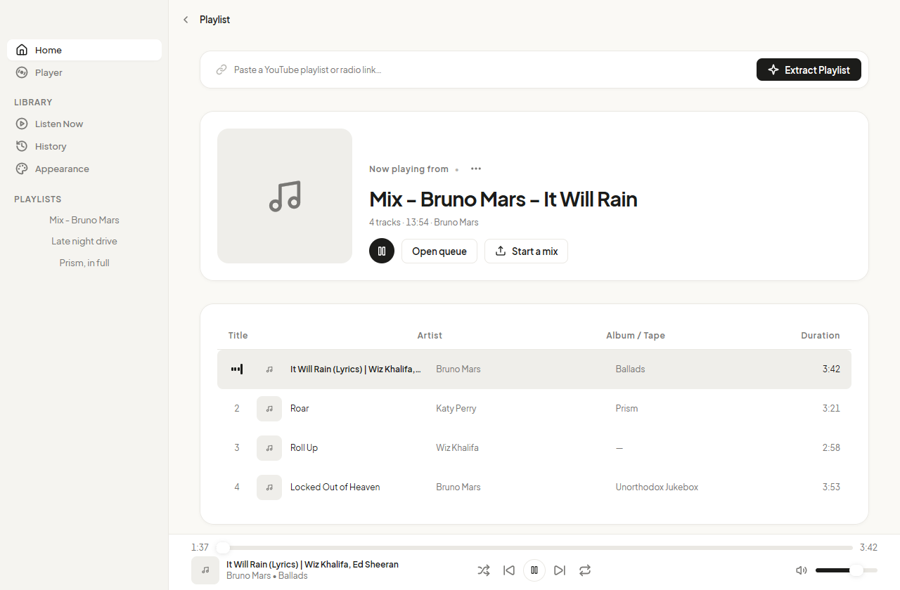
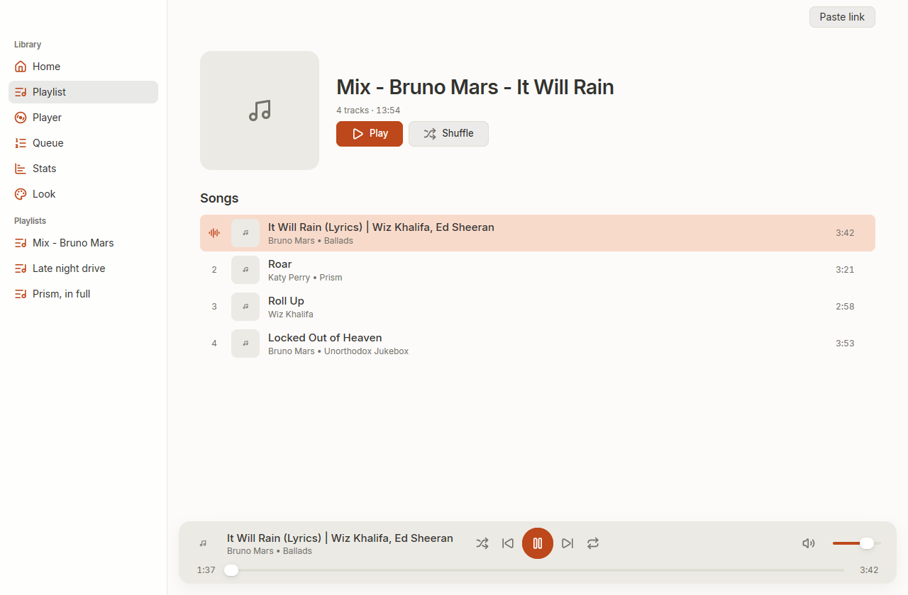
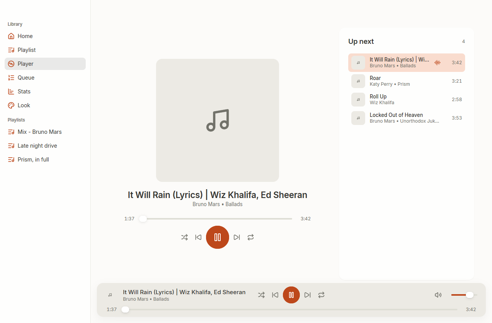
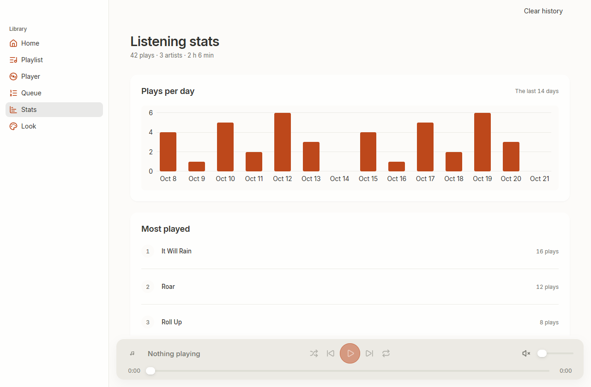
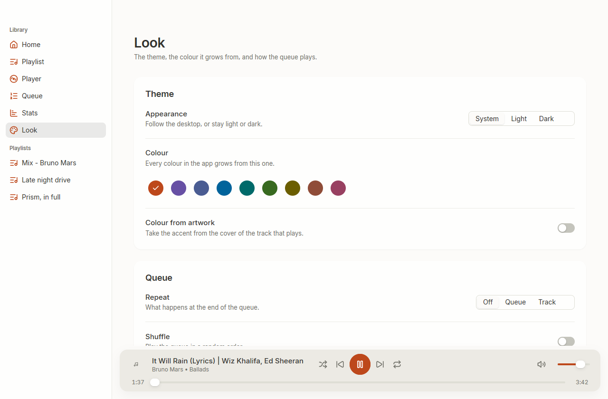
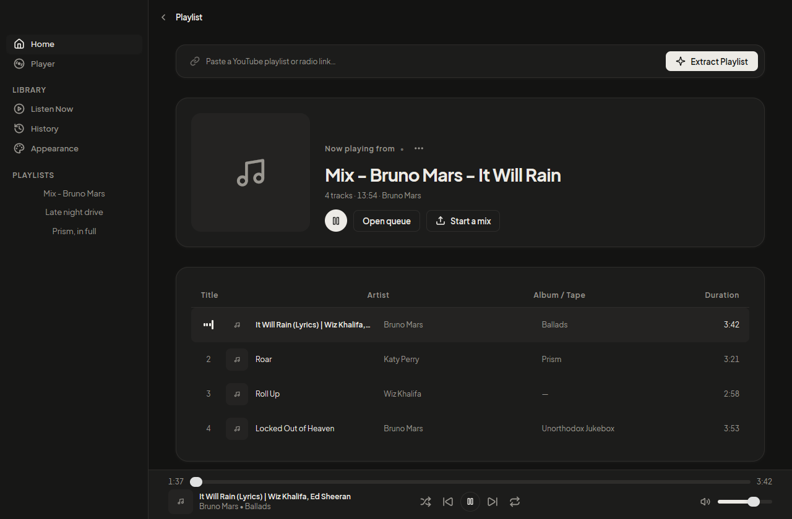

# playlist

A native desktop player for YouTube playlists. Paste a link, and it plays the
music of it.

No webview, no browser engine, no Electron. The window is drawn by the GPU
through [MyGo](https://mygo.egoist.dev), and the controls come from
[Onevra](https://oneo-me.github.io/onevra/).



## What it does

- Reads a playlist from YouTube Music, or any playlist of YouTube: title,
  artist, album, artwork and length for every track.
- Plays the audio, never the video.
- Keeps a queue, with shuffle and repeat, and remembers what played.
- **Opens where you left off.** The playlist you had is there at once, and the
  track that was playing carries on from where it stopped, not from the top of
  the queue.
- **Reads a playlist once.** The tracks are kept on disk, so opening the same
  playlist again needs no network at all.
- Shows what you listened to: plays per day, and the tracks played most.
- Lives in the notification area, so the music outlives the window. Closing the
  window hides it; the tray brings it back, and the media keys work from any
  application.

## Screenshots

| | |
|---|---|
|  |  |
| The playlist, its cover and its songs | The player, and what plays next |
|  |  |
| Plays per day, and the tracks played most | The theme, the colour, and the queue |

The accent follows the cover of the track that plays, and every colour in the
app is derived from it. Dark mode follows the desktop:



## Requirements

Three programs do the work, and all three are needed to play:

| Program | What it does |
|---|---|
| InnerTube | reads the playlist: title, artist, album, artwork, length |
| [yt-dlp](https://github.com/yt-dlp/yt-dlp) | finds the audio of one track |
| [ffmpeg](https://ffmpeg.org) | decodes the stream into PCM for the player |

The app says plainly when one is missing rather than failing quietly.

## Running it

```powershell
go tool mygo dev      # runs the app, rebuilding on every change
go tool mygo build    # packages the app in build/
```

## How it is put together

```
main.go                 entry point only: calls src.Run()
src/                    the interface, one package
  app.go                the state, the window, what the app does
  shell.go              the sidebar, the page frame, the player bar's room
  page_*.go             one file per page
  playerbar.go          the transport, the place in the track, the volume
  widgets.go            the type roles, and the pieces every page is built from
  theme.go              the scale: space, type, tracking, leading, motion
  surfaces.go           the few faces the app paints
  assets.go             Inter, embedded
internal/
  music                 the domain model: Track, Playlist
  innertube             the InnerTube client and the reading of its answer
  ytdlp                 yt-dlp: the audio of a track
  ffmpeg                the decoder that feeds MyGo's audio package
  player                the engine: queue, shuffle, repeat, autoplay
  playlist              the loader that picks the reader that knows the playlist
  library               what the app remembers between runs
```

Three rules hold it together:

**The view is a function of the state.** The engine reports what happens on a
channel; the window applies it on the thread that draws. Nothing is drawn from
a field that something else is writing.

**One scale.** Every distance is a multiple of the theme's spacing, every size
of its font size, every corner of its radius. Type has four sizes and three
weights, and a page uses the roles rather than writing a size. Two tests read
the source and fail on a page that writes a size or a colour by hand.

**The lock is not reentrant.** `a.mu` guards the state the engine writes, so a
method that holds it may not call one that takes it again: the second `Lock`
never returns and the window freezes. The engine's reports are applied by a
method that hands the tray what it needs, instead of letting the tray ask for
it. A test runs that path on a deadline, and another reads the source for the
pattern.

## Tests

```powershell
go test ./...                    # the pure logic, and the views
go test -tags e2e ./...          # reads real playlists, decodes real audio
go test ./src/ -run TestDrawPages # writes a picture of every page to look at
```

The look is checked, not just drawn: the design tests fail on a size or a colour
written by hand, on a text role under 12 DIPs, on a flat hierarchy, and on a
page that runs under the header or into the player bar.

## Licence

The code is the author's. Inter is under the SIL Open Font License; see
`src/assets/fonts/OFL.txt`.
